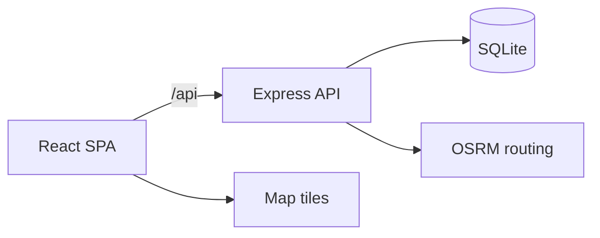

# Rapid Rescue Grid

> **Status: alpha / simulation.** Rapid Rescue Grid is a demonstration of
> emergency dispatch workflows. It is **not** a real emergency service, is
> **not** medical advice, and must **not** be used with real patient data.
> See [docs/DATA_DISCLAIMER.md](docs/DATA_DISCLAIMER.md).

[](https://github.com/radheshyam-bhati/Emergency/actions/workflows/ci.yml)
[](https://github.com/radheshyam-bhati/Emergency/actions/workflows/codeql.yml)
[](LICENSE)

Rapid Rescue Grid is a full-stack simulation of an emergency dispatch command
center: incident intake, hospital ranking, ambulance assignment, routing, and
operator visibility. It is built to make dispatch decisions **explainable**:
the system records why a hospital and ambulance were selected, which options
were rejected, and how the decision unfolded.

## Features

- Dispatcher and admin authentication
- Emergency intake with severity classification
- Explainable hospital ranking based on distance, capability, capacity, and specialization
- Ambulance assignment with queueing and fallback handling
- Map-based visualization and route ETAs
- Metrics, activity log, and dispatch replay
- Persistent SQLite storage for local development and demos
- React dashboard UI with Tailwind CSS and shadcn/ui

## Architecture



See [docs/ARCHITECTURE.md](docs/ARCHITECTURE.md) for components, data flow,
decision logic, and known limitations.

## Tech stack

**Frontend:** React, TypeScript, Vite, TanStack Query, Tailwind CSS,
shadcn/ui, Leaflet, Recharts, Framer Motion.

**Backend:** Node.js, Express, TypeScript, SQLite, better-sqlite3, JWT, Zod,
bcryptjs.

**Tooling:** Vitest, ESLint, TypeScript, tsx, GitHub Actions.

## Quick start

### Prerequisites

- Node.js 22 LTS
- npm 10+
- A C++ build toolchain if `better-sqlite3` has no prebuilt binary for your platform

### Setup

```sh
git clone https://github.com/radheshyam-bhati/Emergency.git
cd Emergency
npm ci
cp .env.example .env
```

Generate a real JWT secret and put it in `.env`:

```sh
openssl rand -base64 48
```

Set local demo credentials in `.env` if you want seeded demo accounts. Then:

```sh
npm run db:seed
npm run dev
```

- Frontend: http://localhost:8080
- API: http://localhost:3001
- Liveness: http://localhost:3001/api/health
- Readiness: http://localhost:3001/api/ready

Demo accounts are created only when `SEED_DEMO_DATA=true`. They are for local
development only; do not publish working credentials in the README.

### Scripts

| Script | Purpose |
|---|---|
| `npm run dev` | Start client and server |
| `npm run dev:client` | Start Vite only |
| `npm run dev:server` | Start the API only |
| `npm run build` | Build client and server |
| `npm run typecheck` | Type-check client and server |
| `npm run lint` | Run ESLint |
| `npm test` | Run Vitest |
| `npm run check` | Typecheck, lint, test, and build |
| `npm run db:seed` | Reset and seed the **development** database |

## Configuration

See [.env.example](.env.example) and [docs/DEPLOYMENT.md](docs/DEPLOYMENT.md).

| Variable | Required | Purpose |
|---|---|---|
| `JWT_SECRET` | Yes | 32+ character signing secret |
| `API_PORT` | No | API port, default `3001` |
| `DATABASE_PATH` | No | SQLite path; use a temp path in tests |
| `CORS_ORIGINS` | Production | Comma-separated allowed origins |
| `TRUST_PROXY` | No | Set `true` only behind a trusted reverse proxy |
| `SEED_DEMO_DATA` | No | `true` only in local development |
| `DEMO_*` | No | Local demo account email/password values |
| `VITE_API_URL` | Production | API base URL when not same-origin |

## API

The API is mounted under `/api`. Protected routes require
`Authorization: Bearer <token>`. See [docs/API.md](docs/API.md) for the endpoint
table and examples.

## Testing

```sh
npm test
npm run typecheck
npm run lint
npm run build
```

Tests use a temporary SQLite database and do not touch `server/data`. The test
environment sets its own JWT secret and demo credentials.

## Deployment

GitHub Pages cannot host the Express API. The frontend must be deployed as a
static build and the API must run on a Node host with a persistent disk, or the
storage layer must be migrated to a managed database.

See [docs/DEPLOYMENT.md](docs/DEPLOYMENT.md) for a split frontend/API
deployment, environment variables, health checks, and backup guidance.

## Limitations

- **Simulation only.** No real dispatch, medical, or emergency guarantees.
- **Polling, not real-time.** The UI refreshes on an interval; there is no
  WebSocket/SSE event stream yet.
- **SQLite single-writer architecture.** Not horizontally scalable as-is.
- **No MFA, account recovery, or production-grade audit logging yet.**
- **Public OSRM/map services.** Do not send real patient data to public routing
  or tile services.
- **No compliance certification.** The project is not HIPAA/GDPR/DPDP compliant
  and should not process real health data.

## Security

Please report vulnerabilities privately per [SECURITY.md](SECURITY.md). Do not
open a public issue for a security report. Do not include real patient data,
credentials, or personal information in reports.

## Contributing

See [CONTRIBUTING.md](CONTRIBUTING.md) and
[CODE_OF_CONDUCT.md](CODE_OF_CONDUCT.md). Good first issues are labeled
`good first issue`.

## Roadmap

See [ROADMAP.md](ROADMAP.md) and the GitHub milestones:
`v0.1.0 — Security baseline`, `v0.2.0 — Open-source launch`, and
`v0.3.0 — Production readiness`.

## License

MIT — see [LICENSE](LICENSE).

## Acknowledgements

Built with React, Vite, Express, SQLite, shadcn/ui, Leaflet, Recharts, and the
open-source community. Hospital and patient data in the seed set are synthetic;
any resemblance to real organizations is coincidental.
