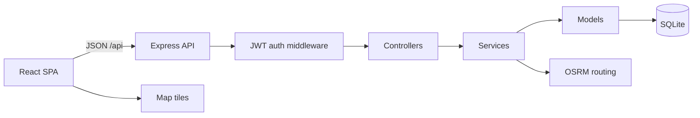

# Architecture

## Overview

Rapid Rescue Grid is a single npm package with a React client and an Express
API. The client is built by Vite; the server is compiled by TypeScript and runs
on Node.js. SQLite is used for local persistence.

## Client

- `src/pages` — route-level screens
- `src/components` — UI and domain components
- `src/hooks/useSimulation.ts` — TanStack Query polling and mutations
- `src/api` — typed API client
- `src/contexts/AuthContext.tsx` — session state
- `src/types/domain.ts` — client domain types

The client polls the API on an interval. There is no WebSocket/SSE transport
yet, so “real-time” in the UI means near-real-time polling.

## Server

- `server/src/routes` — route definitions
- `server/src/controllers` — request validation and HTTP responses
- `server/src/services` — business logic, including the dispatch engine
- `server/src/models` — SQLite queries and row mapping
- `server/src/db` — schema, migrations, seed data
- `server/src/config/env.ts` — environment validation
- `server/src/app.ts` — middleware and route mounting
- `server/src/server.ts` — startup, seeding guard, graceful shutdown

## Dispatch flow

1. A dispatcher creates an emergency.
2. The Smart Emergency Allocation Engine ranks eligible hospitals using
   severity, distance, specialization, and capacity.
3. The engine selects an available ambulance.
4. The hospital and ambulance are linked to the emergency.
5. A dispatch record and ranking snapshot are persisted.
6. If no ambulance or capable hospital exists, the emergency is queued with a
   reason and retried by the lifecycle loop.

The ranking snapshot is the explainability contract: it records the selected
option, rejected alternatives, and the reason for each rejection.

## Data model

Main tables:

- `users`
- `hospitals`
- `ambulances`
- `emergencies`
- `dispatches`
- `activity_logs`

SQLite runs in WAL mode. The schema is created from `server/src/db/schema.sql`;
small additive migrations are applied at startup. There is no versioned
migration framework yet.

## Known architectural limits

- Single-process SQLite; no horizontal scaling.
- In-process lifecycle loop; multiple API instances would duplicate simulation.
- Polling instead of event streaming.
- No job queue or outbox for reliable external side effects.
- Public OSRM and map tiles; not suitable for real patient data.
- No shared type package; client and server types can drift.

## Security boundaries

- The API is the trust boundary; never trust client-supplied roles.
- Public signup creates dispatcher accounts only.
- Admin-only actions must use server-side role checks.
- JWTs are currently stored in `localStorage`; moving to HttpOnly cookies is a
  planned hardening item.
- Do not send real patient data to public routing or map services.

## Future direction

- PostgreSQL with versioned migrations.
- SSE/WebSocket event stream or an event bus.
- Stateless API instances and a separate simulation worker.
- Structured logging, metrics, and tracing.
- End-to-end tests for the dispatch workflow.
